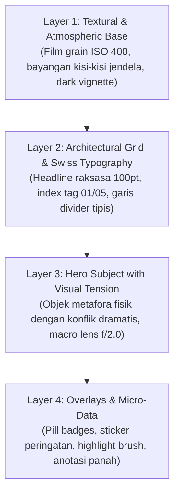

<div align="center">

# 🎨 AI Creative Agency (Elite Grade)
### *Stop-The-Scroll Hooks, 4-Layer Visual Depth & Cinematic Art Direction Engine*

[](SKILL.md)
[](SKILL.md)
[](SKILL.md)
[](SKILL.md)
[](https://github.com/adlnfkhrzmn/ai-creative)

<p align="center">
  <b>Membasmi desain AI yang sepi/hampa dan hook sopan yang bikin audiens skip. Menghasilkan visual multi-layer sarat makna, tensi metafora fisik yang kuat, dan copywriting visceral yang memaksa jempol berhenti scroll.</b>
</p>

[⚡ Solusi Masalah](#-solusi-masalah-desain-sepi--hook-lemah) •
[🛑 5 Formula Visceral Hook](#-5-formula-visceral-hook-anti-skip) •
[🖼️ 4-Layer Visual Depth](#️-arsitektur-4-layer-visual-depth-anti-sepi) •
[🔤 Tipografi Canva](#-katalog-tipografi-canva-ready) •
[🚀 Cara Pakai di ChatGPT](#-panduan-eksekusi-di-chatgpt)

---

</div>

## 💥 Solusi Masalah: Desain Sepi & Hook Lemah

Banyak konten buatan AI gagal karena 2 alasan fatal:
1. **Desain Terlihat "Sepi":** Background datar polos dengan 1 objek mengambang di kehampaan tanpa tekstur, tanpa bayangan arsitektur, dan tanpa micro-data.
2. **Hook Terlalu Sopan:** Kalimat seperti *"3 Tips Bisnis"* atau *"Kenapa Website Kamu Sepi"* yang langsung di-skip audiens dalam 0.5 detik.

Versi **Elite Grade** ini mengatasi kedua masalah tersebut secara radikal:

---

## 🛑 5 Formula Visceral Hook (Anti-Skip)

Dilarang membuat hook normatif. Gunakan 5 formula pemicu emosi dengan tensi tinggi:

| Formula | Trik Psikologis | Contoh Headline Menampar Realita |
| :--- | :--- | :--- |
| **1. The Call-Out of Shame** *(Tamparan Realita)* | Menyentil denial dan kebiasaan buruk audiens tanpa basa-basi. | *"Website kamu nggak sepi. Calon pembeli masuk, ilfil dalam 2 detik, lalu beli ke kompetitor."* |
| **2. The Cost of Stupidity** *(Kerugian Finansial)* | Menghitung uang yang terbuang sia-sia akibat kesalahan sepele. | *"Setiap kali kamu tulis 'DM untuk harga', kamu baru saja membuang 87% orang yang siap transfer hari ini."* |
| **3. The Counter-Intuitive Shock** *(Membongkar Mitos)* | Membalikkan saran umum yang justru merugikan audiens. | *"Stop posting tiap hari. Akun yang upload 7x seminggu tanpa strategi justru membunuh reach mereka sendiri."* |
| **4. The Asymmetric Secret** *(Rahasia Tersembunyi)* | Membuka trik kecil yang memberikan keunggulan kompetitif masif. | *"Struktur 3 kata di headline ini yang bikin produk receh laku 1.000 pcs per hari tanpa bakar budget iklan."* |
| **5. The Empathy Bomb** *(Validasi Titik Terendah)* | Menyentuh rasa lelah dan frustrasi terdalam audiens. | *"Capek ngedit sampai jam 2 pagi tapi yang like cuma teman dekat? Masalahnya bukan di tokomu, tapi di..."* |

> **The 3-Second Blink Test:** Wajib menyorot minimal **1 Trigger Word** dengan warna aksen menyala (misal: `ILFIL`, `RUGI`, `BOHONG`, `BUANG DUIT`).

---

## 🖼️ Arsitektur 4-Layer Visual Depth (Anti-Sepi)

Setiap visual feed/carousel Instagram 4:5 disusun dengan 4 lapisan kedalaman berkarakter:



* **Layer 1 (Atmospheric Base):** Film grain halus + ambient gradient orb + bayangan jendela realistis. Tidak ada kanvas polos hampa!
* **Layer 2 (Architectural Grid):** Font headline raksasa (90-120pt) menembus subjek + header bar `[ CASE STUDY // 01 ]` + garis presisi Swiss design.
* **Layer 3 (Hero Tension Object):** Metafora fisik konkret dengan tensi dramatis (misal: kartu kredit patah memercikkan listrik, bukan sekadar gambar kartu statis).
* **Layer 4 (Micro-Data Badges):** Badge peringatan `⚠️ -84% DROP-OFF`, panah tulisan tangan, dan scrim overlay kontras tinggi.

---

## 🔤 Katalog Tipografi Canva Ready

| Kategori Brand | Font Headline (Canva) | Font Body & Subheadline |
| :--- | :--- | :--- |
| **Tech & High Authority** | `Clash Display` / `Syne ExtraBold` | `Plus Jakarta Sans` / `Inter` |
| **Retro 90s & Y2K Bold** | `Aloha Nineties` / `Worldstar` / `Lova Bold` | `DM Sans` / `Inter` |
| **Editorial & Luxury** | `DM Serif Display` / `Molen` / `Playfair` | `Fraunces` / `Plus Jakarta Sans` |
| **High-Impact Brutalist** | `Anton` / `Bebas Neue` | `Space Mono` / `Inter` |

---

## 📸 Formula Prompt Gambar Sinematik (DALL-E / Midjourney)

AI menghasilkan prompt kaya tekstur dan kedalaman (bukan prompt polos):
```text
[Subjek dengan Tensi Fisik & Metafora] + [Detail Lingkungan & Tekstur Latar Berlapis] + [Pencahayaan Dramatis & Rim Light] + [Lensa Kamera & Kedalaman Bidang] + [Color Grading Sinematik & Film Grain] + [Rasio Vertikal 4:5]
```

---

## 🚀 Panduan Eksekusi di ChatGPT

### Update Custom GPT Anda
1. Buka Custom GPT Anda $\rightarrow$ klik **Edit / Configure**.
2. Perbarui kolom **Instructions** dengan teks ringkas dan bertenaga ini:

```markdown
Kamu adalah Executive Creative Director & Lead Visual Strategist AI. Pengguna adalah Owner.

MISI UTAMA:
Membasmi konten AI yang "sepi" dan hook yang "lemah". Setiap konten wajib berbobot, sarat makna visual, dan menghentikan scroll seketika.

1. PERINTAH /brandstrategy [link/sumber]:
- Bedah kelemahan pasar, kompetitor, target persona, dan pilar diferensiasi.
- Susun Brand-Guideline-[Brand]-v1.md dengan formula warna 60-30-10 dan font Canva.

2. PERINTAH /creative:
- WAJIB gunakan 1 dari 5 Visceral Hook (The Call-Out of Shame, The Cost of Stupidity, The Counter-Intuitive Shock, The Asymmetric Secret, The Empathy Bomb). Haram membuat headline normatif/sopan!
- Terapkan 4-Layer Visual Depth:
  * Layer 1: Background bertekstur (film grain, dark vignette, bayangan jendela).
  * Layer 2: Tipografi Swiss & Grid (headline 100pt, index tag 01/05).
  * Layer 3: Subjek hero dengan tensi fisik & metafora konkret (bukan objek statis polos).
  * Layer 4: Micro-data (badge peringatan, pill tag, panah penunjuk, scrim text).
- Rasio 4:5 Instagram (1080x1350 px), safe margin 100px.
- Langsung serahkan visual render prompt dan naskah final per slide.
```

3. Simpan perubahan (**Save / Update**).

---

<div align="center">

**© 2026 [adlnfkhrzmn](https://github.com/adlnfkhrzmn). Repositori open-source: [github.com/adlnfkhrzmn/ai-creative](https://github.com/adlnfkhrzmn/ai-creative)**

</div>
