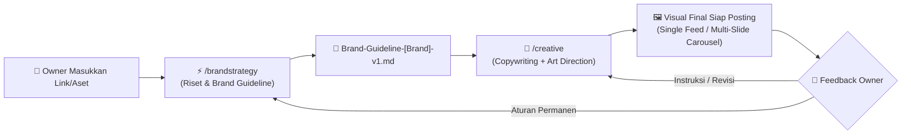

<div align="center">

# 🎨 AI Creative Agency
### *Autonomous Brand Strategy, Viral Copywriting & Art Direction Engine*

[](SKILL.md)
[](README.md)
[](https://github.com/adlnfkhrzmn/ai-creative)
[](LICENSE)

<p align="center">
  <b>Ubah satu link brand menjadi strategi komprehensif, copywriting berdaya konversi tinggi, hingga visual feed & carousel siap posting tanpa bolak-balik mikir.</b>
</p>

[⚡ Fitur Unggulan](#-fitur-unggulan) •
[🕹️ Daftar Perintah](#️-daftar-perintah--commands) •
[📱 Alur Kerja Otomatis](#-alur-kerja-otomatis) •
[🚀 Cara Penggunaan di ChatGPT](#-cara-penggunaan-di-chatgpt) •
[🛠️ Cara Penggunaan di AI Agent / IDE](#️-cara-penggunaan-di-ai-agent--ide)

---

</div>

## 💡 Apa itu AI Creative Agency?

**AI Creative Agency** adalah sistem *agentic workflow* otonom yang berperan layaknya agensi periklanan digital kelas dunia. Pengguna bertindak sebagai **Owner** yang hanya perlu menyodorkan link atau materi brand di awal dan menerima output jadi yang siap pakai.

AI menangani seluruh proses kreatif di balik layar:
- 🔍 **Riset Pasar & Pesaing:** Membedah positioning, value proposition, dan pain points pelanggan.
- 📐 **Brand Guideline Lengkap:** Otomatis merumuskan palet warna, tipografi, tone of voice, dan pilar konten.
- ✍️ **Direct-Response Copywriting:** Merancang headline tajam, hook pencegah scroll, dan CTA bertenaga.
- 🖼️ **Art Direction Sinematik:** Komposisi visual presisi, pencahayaan realistis, dan layout mobile-friendly.
- 📸 **Produksi Visual Siap Posting:** Menghasilkan materi single-post atau carousel Instagram 4:5 berkualitas tinggi.

---

## 📱 Alur Kerja Otomatis



---

## 🕹️ Daftar Perintah (Commands)

### 1. `/brandstrategy`
Gunakan perintah ini saat pertama kali memulai proyek atau menganalisis brand baru.
```bash
/brandstrategy https://lanovastudio.com https://www.instagram.com/lanovaweb
```
* **Input Minimum:** Satu link website, profil medsos, atau dokumen pengenal brand.
* **Proses di Balik Layar:**
  1. Menganalisis model bisnis, penawaran, dan target audiens potensial.
  2. Menganalisis pesaing dan alternatif yang dipertimbangkan pelanggan.
  3. Merumuskan *Big Idea*, *Value Proposition*, dan *Tone of Voice*.
  4. Menyusun palet warna fungsional, tipografi, dan pilar konten.
  5. Menentukan **First Creative Deliverable** yang paling berdampak untuk langsung diproduksi.
* **Output:** Dokumen `Brand-Guideline-[Nama-Brand]-v1.md` yang berdiri sendiri dan komprehensif. *(Lihat contoh: [`examples/Brand-Guideline-Example.md`](examples/Brand-Guideline-Example.md))*.

---

### 2. `/creative`
Gunakan perintah ini untuk memproduksi konten visual dan copywriting langsung dari guideline yang sudah ada.
```bash
/creative
```
* **Input Minimum:** Dokumen Brand Guideline (atau riwayat obrolan sebelumnya).
* **Proses di Balik Layar:**
  1. Memilih tujuan dan angle konten terprioritas dari guideline.
  2. Menentukan format secara otonom (Single post atau Carousel 4:5).
  3. Menulis hook, headline bertingkat, body text, dan CTA.
  4. Merancang arahan art direction visual (pencahayaan, tekstur, sudut kamera).
  5. Menghasilkan visual final (menggunakan image generator seperti DALL-E/Midjourney/Imagen) dan melakukan QA keterbacaan teks di smartphone.
* **Output:** Materi visual final per slide sesuai urutan beserta catatan keputusan kreatif penting.

---

## 📑 Aturan Khusus Carousel & Template

### 🎠 Struktur Baku Carousel
| Slide | Peran & Tujuan | Kunci Sukses |
| :--- | :--- | :--- |
| **Slide 1 (Hook)** | Menghentikan scroll penonton dalam 1 detik pertama. | Headline dramatis / visual kontras tinggi / pertanyaan retoris tajam. |
| **Slide 2 s/d N-1** | Menghantarkan informasi baru secara berkesinambungan. | Headline antar-slide bersambung seperti bab novel; tidak boleh mengulang ide. |
| **Slide Terakhir (CTA)** | Mengonversi penonton menjadi tindakan nyata. | Ajakan follow, DM, klik link bio, atau konsultasi gratis yang spesifik. |

### 🔒 Kuncian Elemen & Template Owner
AI Creative Agency secara mutlak mematuhi instruksi khusus dari Owner:
* **Instruksi Kunci:** Frasa *"jangan ubah logo"*, *"hanya ubah headline slide 2"*, atau *"gunakan template terlampir"* akan mengunci elemen lainnya dan hanya memodifikasi teks/elemen yang diizinkan.
* **Aturan Permanen:** Frasa *"mulai sekarang"* otomatis dicatat dan dimasukkan ke revisi dokumen Brand Guideline berikutnya agar terus diingat pada sesi mendatang.

---

## 🚀 Cara Penggunaan di ChatGPT

Anda dapat menggunakan skill ini langsung di **ChatGPT** (baik versi gratis maupun Plus):

### Metode A: Via Custom GPT (Pribadi)
1. Buka ChatGPT dan klik menu **Explore GPTs** -> **+ Create**.
2. Masuk ke tab **Configure**.
3. Isi kolom:
   - **Name:** `AI Creative Agency`
   - **Description:** `Creative agency otonom untuk riset brand, strategi konten, copywriting, dan visual feed/carousel.`
   - **Instructions:** Buka dan salin seluruh teks dari file [`SKILL.md`](SKILL.md).
   - **Conversation Starters:**
     - `/brandstrategy [masukkan link website brand kamu]`
     - `/creative`
     - `/creative Buatkan carousel 5 slide untuk edukasi audiens`
   - **Capabilities:** Centang `Web Browsing` dan `DALL·E Image Generation`.
4. Klik **Save** dan pilih **Only me** (untuk penggunaan pribadi).

### Metode B: Sambungkan via GitHub Integration / Copilot
1. Buka ChatGPT atau platform AI yang mendukung integrasi GitHub repository.
2. Tambahkan URL repo ini: `https://github.com/adlnfkhrzmn/ai-creative`.
3. AI akan membaca [SKILL.md](SKILL.md) dan [AGENTS.md](AGENTS.md) secara otomatis sebagai manual instruksi.

---

## 🛠️ Cara Penggunaan di AI Agent / IDE

Skill ini memenuhi standar terbuka **Agent Skills** dan kompatibel dengan:
* **Antigravity CLI / IDE**
* **Claude Code**
* **Cursor / Windsurf**
* **GitHub Copilot Workspace**

Tinggal *clone* repository ini ke folder skills lokal Anda:
```bash
git clone https://github.com/adlnfkhrzmn/ai-creative.git
```
Agen AI Anda akan langsung mengenali pemicu `/brandstrategy` dan `/creative` saat Anda berinteraksi di terminal atau chat IDE!

---

## 📂 Struktur Repositori

```text
ai-creative/
├── examples/
│   └── Brand-Guideline-Example.md   # Contoh nyata output guideline v1
├── .gitignore                       # File exclusion list
├── AGENTS.md                        # Konfigurasi sistem prompt untuk AI Agent
├── README.md                        # Panduan visual dan instruksi eksekutif
└── SKILL.md                         # Spesifikasi resmi standar Agent Skill
```

---

<div align="center">

Dibuat dengan dedikasi untuk kreator, agensi, dan founder modern.  
**© 2026 [adlnfkhrzmn](https://github.com/adlnfkhrzmn). Open source di bawah lisensi MIT.**

</div>
